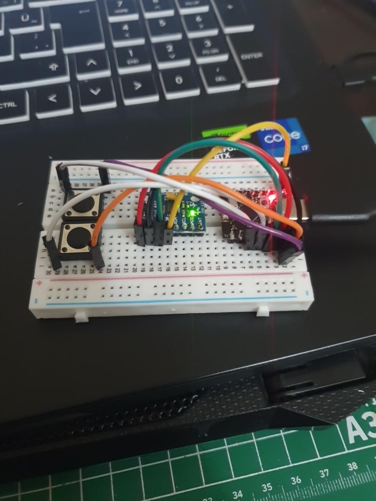
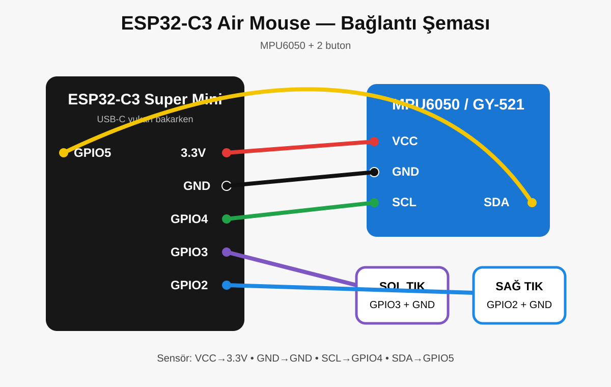
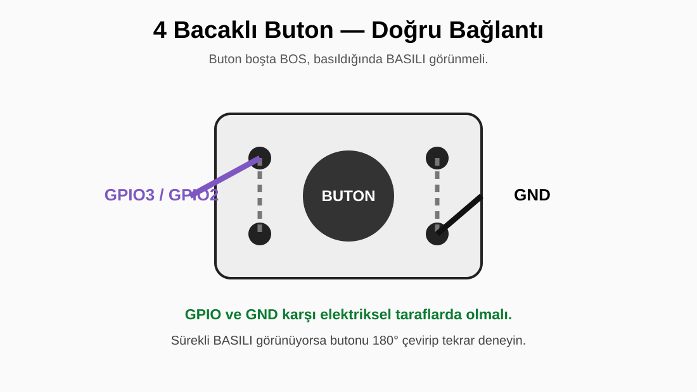
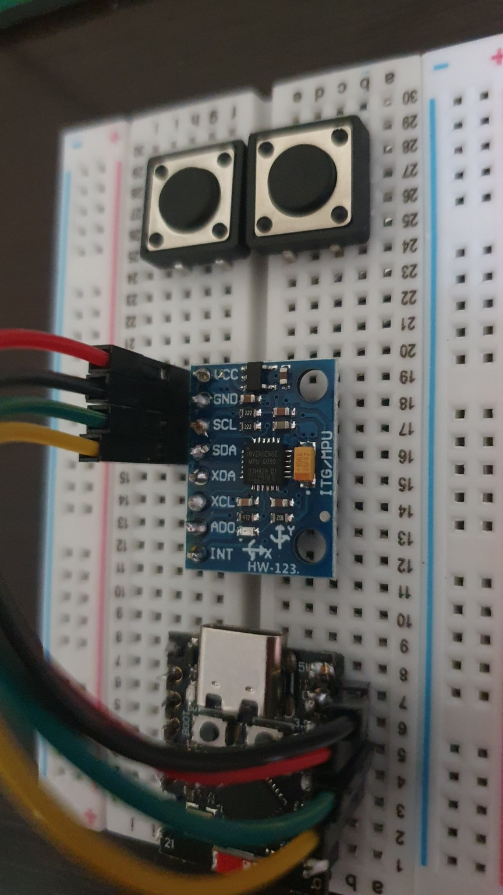
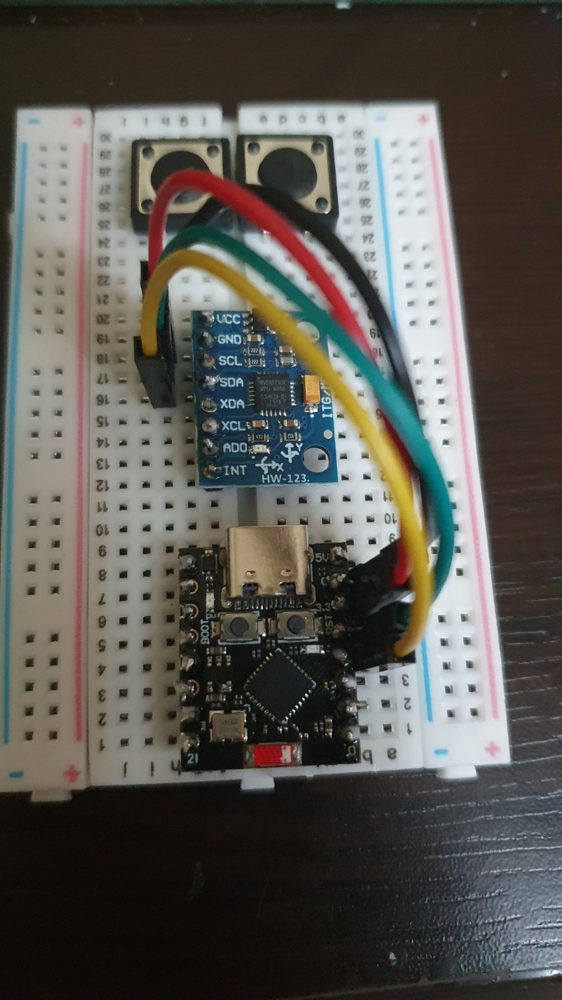

# ESP32-C3 Air Mouse

ESP32-C3 Super Mini ve MPU6050 kullanılarak yapılan, **havada el hareketleriyle kontrol edilebilen Bluetooth mouse** projesi.

Kartı havada hareket ettirdiğinizde bilgisayardaki imleç hareket eder. İki fiziksel buton sol/sağ tık için kullanılır; uzun basışlarla kaydırma yapılabilir.



## Özellikler

- Bluetooth Low Energy (BLE) HID mouse
- MPU6050 jiroskop ile imleç kontrolü
- Sol tık ve sağ tık
- Uzun basış ile yukarı/aşağı kaydırma
- Hassasiyet, smoothing ve deadzone ayarları
- ESP32-C3 Super Mini ile kompakt yapı
- USB-C üzerinden programlama ve test

## Gerekli parçalar

| Parça | Adet |
|---|---:|
| ESP32-C3 Super Mini | 1 |
| MPU6050 / GY-521 | 1 |
| 4 bacaklı tactile buton | 2 |
| Breadboard | 1 |
| Jumper kablo | Gerektiği kadar |
| USB-C veri kablosu | 1 |

## Bağlantı şeması



| Parça | ESP32-C3 |
|---|---|
| MPU6050 VCC | 3.3V |
| MPU6050 GND | GND |
| MPU6050 SCL | GPIO4 |
| MPU6050 SDA | GPIO5 |
| Sol tık butonu | GPIO3 + GND |
| Sağ tık butonu | GPIO2 + GND |

> MPU6050 için `XDA`, `XCL`, `AD0` ve `INT` pinleri bu projede kullanılmıyor.

## Buton bağlantısı



4 bacaklı tactile butonlarda aynı elektriksel taraftaki iki bacak zaten birbirine bağlıdır. Yanlış yönde bağlanırsa Seri Monitör'de buton sürekli **BASILI** görünebilir.

Doğru davranış:

```text
Butona basmıyorken : BOS
Butona basarken    : BASILI
```

Sürekli BASILI görünüyorsa butonu **180° çevirip** tekrar deneyin.

## Arduino IDE kurulumu

1. Arduino IDE'yi açın.
2. ESP32 kart paketini **Espressif Systems** üzerinden kurun.
3. Kart olarak **ESP32C3 Dev Module** seçin.
4. Aşağıdaki kütüphaneleri kurun:
   - `MPU6050_tockn`
   - `HijelHID_BLEMouse`
   - `NimBLE-Arduino` (2.3.8 veya üzeri)
5. `src/ESP32-C3-Air-Mouse.ino` dosyasını Arduino IDE ile açın.
6. Doğru COM portunu seçip karta yükleyin.

## Ön test: MPU6050

Sensör doğru bağlandığında I2C taramasında tipik olarak şu adres görülür:

```text
I2C cihaz bulundu: 0x68
```

Bu, ESP32-C3 ile MPU6050 arasındaki I2C haberleşmesinin çalıştığını gösterir.

## İlk çalıştırma ve Bluetooth

Firmware yüklendikten veya kart yeniden başlatıldıktan sonra cihazı birkaç saniye **düz ve tamamen hareketsiz** bırakın. Başlangıçta jiroskop kalibrasyonu yapılır.

Windows'ta:

```text
Ayarlar
→ Bluetooth ve cihazlar
→ Cihaz ekle
→ Bluetooth
→ COMET AIRMOUSE
```

Bağlandıktan sonra kartı havada hareket ettirerek imleci kontrol edebilirsiniz.

## Kontroller

| Hareket | İşlev |
|---|---|
| Kartı sağa/sola hareket ettirme | İmleç X ekseni |
| Kartı yukarı/aşağı hareket ettirme | İmleç Y ekseni |
| Sol butona kısa basma | Sol tık |
| Sağ butona kısa basma | Sağ tık |
| Sol butona uzun basma | Aşağı kaydır |
| Sağ butona uzun basma | Yukarı kaydır |

## Hassasiyet ayarı

Firmware içinde şu değerlerle oynayabilirsiniz:

```cpp
float smoothing   = 0.82;
float sensitivity = 0.20;
int deadzone = 1;
```

- `sensitivity`: imleç hızını değiştirir.
- `smoothing`: hareketin ne kadar yumuşatılacağını belirler.
- `deadzone`: çok küçük istemsiz hareketleri yok sayar.

## Gerçek prototip fotoğrafları

### Sensör bağlantıları



### Breadboard kurulumu



## Sorun giderme

### MPU6050 görünmüyor

- VCC → **3.3V**
- GND → **GND**
- SCL → **GPIO4**
- SDA → **GPIO5**
- I2C taramasında `0x68` kontrol edin.

### Buton sürekli BASILI görünüyor

Butonun yönünü kontrol edin. GPIO ve GND aynı elektriksel tarafta kalmış olabilir. Butonu 180° çevirip yeniden bağlayın.

### Bluetooth cihazı görünmüyor

- Kartı yeniden başlatın.
- Kalibrasyon sırasında kartı hareket ettirmeyin.
- Arduino IDE'de **ESP32C3 Dev Module** ve doğru COM portunun seçili olduğunu kontrol edin.

### İmleç fazla hızlı veya yavaş

`src/ESP32-C3-Air-Mouse.ino` içindeki `sensitivity`, `smoothing` ve `deadzone` değerlerini değiştirin.

## Kaynak / Credits

Bu fiziksel kurulum ve test dokümantasyonu, açık kaynak **COMET AIR MOUSE** firmware'i temel alınarak hazırlanmıştır:

https://github.com/CoreCometIndustries/COMET-AIR-MOUSE

Firmware MIT lisansı altındadır. Orijinal telif/izin bildirimi bu repodaki [LICENSE](LICENSE) dosyasında korunmuştur. Ayrıntılar için [CREDITS.md](CREDITS.md) dosyasına bakın.
